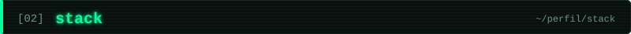
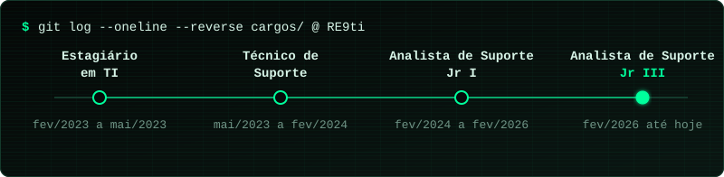
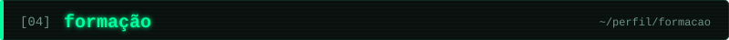

&nbsp;

Trabalho com suporte e infraestrutura de TI há mais de 3 anos, na RE9ti. Sou analista residente em escritórios de advocacia de grande porte em São Paulo, com atendimento direto a sócios e diretores e a responsabilidade de manter sistemas críticos funcionando.

Entrei como estagiário em 2023 e tive três promoções até o cargo atual, Analista de Suporte Jr III. Hoje meu dia a dia é segurança de redes (firewall, DPI e inspeção de pacotes), análise de incidentes e nuvem Microsoft.

Sou formado em Análise e Desenvolvimento de Sistemas e sigo desenvolvendo software nas horas vagas e como freelancer.

&nbsp;

&nbsp;

&nbsp;

- `2022 a 2024` Análise e Desenvolvimento de Sistemas, Universidade Mogi das Cruzes (UMC)
- `2020 a 2022` Técnico em Informática, Senac Tatuapé

&nbsp;

