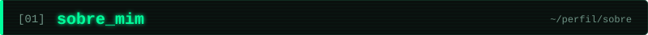
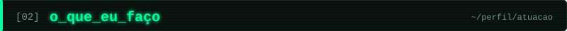
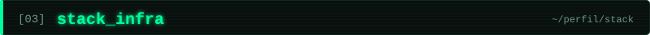
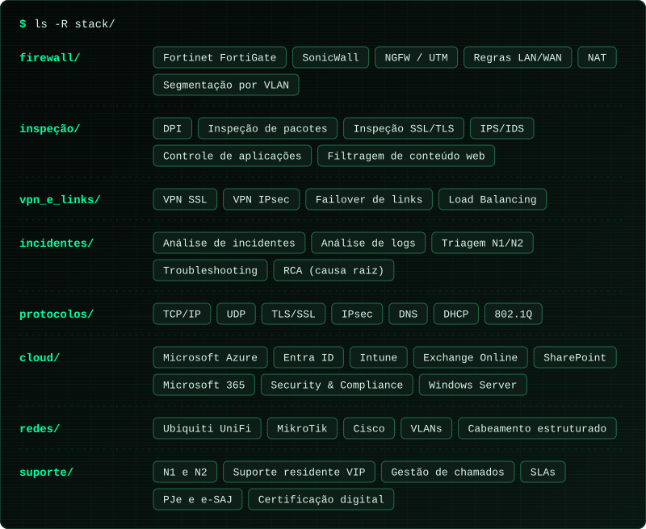
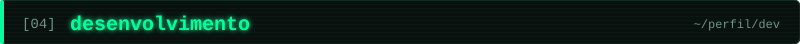
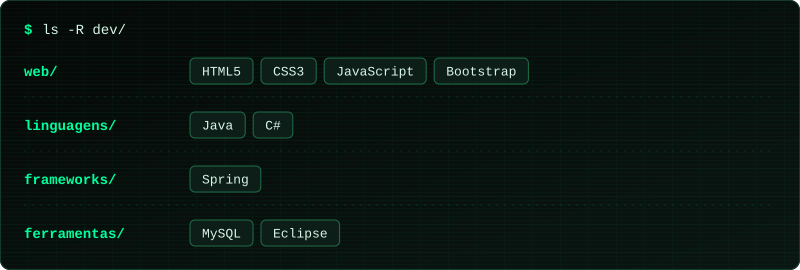
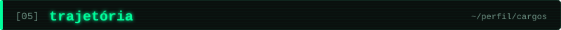
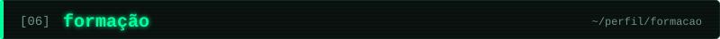

&nbsp;

Trabalho com suporte e infraestrutura de TI há mais de 3 anos, na RE9ti. Sou analista residente em escritórios de advocacia de grande porte em São Paulo, com atendimento direto a sócios e diretores e a responsabilidade de manter sistemas críticos funcionando.

Entrei como estagiário em 2023 e tive três promoções até o cargo atual, Analista de Suporte Jr III. Hoje meu dia a dia é firewall, rede e nuvem Microsoft.

Sou formado em Análise e Desenvolvimento de Sistemas e sigo desenvolvendo software nas horas vagas e como freelancer.

&nbsp;

<table>
  <tr>
    <td width="50%" valign="top">

### `01 // segurança_de_redes`
- Implantação e administração de Fortinet FortiGate e SonicWall
- Políticas de acesso LAN/WAN, NAT e filtragem de conteúdo web
- VPN SSL/IPsec, failover e balanceamento de links

</td>
    <td width="50%" valign="top">

### `02 // cloud_microsoft`
- Identidades e acessos com Entra ID (Azure AD)
- Políticas de segurança e dispositivos no Intune (MDM/MAM)
- Exchange Online, SharePoint e Security and Compliance
- Windows Server on-premises

</td>
  </tr>
  <tr>
    <td width="50%" valign="top">

### `03 // infra_e_redes`
- Ativos Ubiquiti UniFi, MikroTik e Cisco
- DHCP, DNS, NAT e VLANs
- Manutenção de cabeamento estruturado

</td>
    <td width="50%" valign="top">

### `04 // suporte_e_operação`
- Atendimento N1 e N2 e suporte residente VIP
- Diagnóstico de hardware e software, certificação digital, PJe e e-SAJ
- Gestão de chamados, SLAs e treinamento de usuários

</td>
  </tr>
</table>

&nbsp;

&nbsp;

Além da infraestrutura, desenvolvo software nas horas vagas e como freelancer. Estas são as tecnologias que já usei:

&nbsp;

Todos os cargos na RE9ti, a partir de fevereiro de 2023.

&nbsp;

- `2022 a 2024` Análise e Desenvolvimento de Sistemas, Universidade Mogi das Cruzes (UMC)
- `2020 a 2022` Técnico em Informática, Senac Tatuapé

&nbsp;

